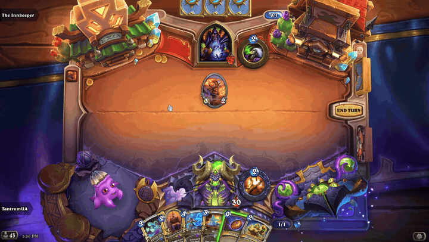
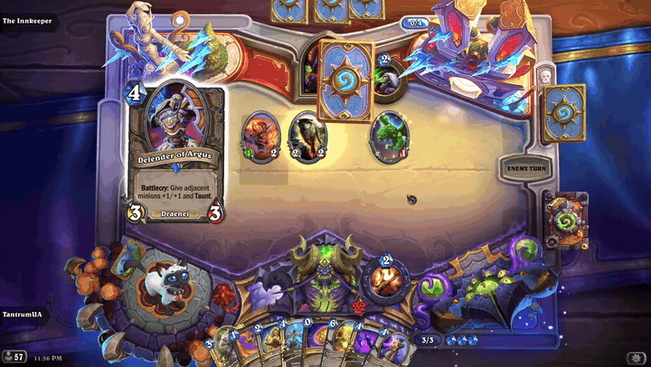

# HS Deck Inspector

Pull a deck off the board in Hearthstone and turn it around in your hands.

- **D** brings out your deck, **F** your opponent's. Drag with the left mouse button to spin it.
- **D**, **F**, **Esc** or a right click sends it back.
- It's as thick as the cards left in it and wears its owner's card back, animated as in the collection.
- Its face is an unknown card: the deck's order stays hidden, and nothing here shows more than the game does.
- **G** lays both decks on the board, card backs up and tilted so you can see how thick they are, and cards are drawn
  from them there. It's off until you turn it on, by key or in the dropdown under **Options > Deck Keys**, and stays as
  you set it between matches. Original idea and design by
  [Sebastientromp](https://github.com/sebastientromp), of [Firestone](https://github.com/Zero-to-Heroes/firestone).
- Change the keys in the game, under **Options > Deck Keys**. Right click a key to unbind it.

Works in every mode with a deck, so not in Battlegrounds or Mercenaries. The game keeps running while a deck is out, the
turn timer included.

## Install

1. Download `HSDeckInspector-Setup-<version>.exe` from [Releases](../../releases).
2. Close Hearthstone and run the setup. It finds your Hearthstone folder; check it and click Install.
3. Start Hearthstone from Battle.net as usual.

The setup brings [BepInEx](https://github.com/BepInEx/BepInEx), the mod loader, if you don't have it yet. Already using
BepInEx? Put `com.tantrumua.deckinspector.dll` from [Releases](../../releases) in `BepInEx\plugins` instead.

**Requirements:** Windows, Hearthstone for PC (made for patch 37.0.2).

## About

An unofficial, client-side mod, not supported by Blizzard. It only changes what you see on your own screen: it plays
nothing for you, shows nothing the game doesn't already show, and sends nothing anywhere.

Copyright 2026 TantrumUA(RTantrumR). Licensed under the [Apache License 2.0](LICENSE); see [NOTICE](NOTICE).
Hearthstone's art, fonts and text that the addon shows stay Blizzard's: they're loaded from your own installation, and
the license doesn't cover them. Built on [BepInEx](https://github.com/BepInEx/BepInEx) and
[HarmonyX](https://github.com/BepInEx/HarmonyX).

Not affiliated with or endorsed by Blizzard Entertainment. Hearthstone is a trademark of Blizzard Entertainment, Inc.
